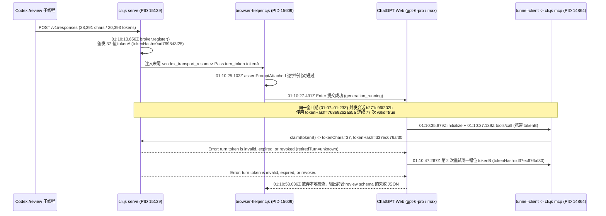

# Codex Native2 `turn_token` 无效/过期/已撤销：调查记录与根因定位

日期：2026-11-22
范围：本机 `codex-chatgpt-web`（Launcher AppImage + Runtime `6.1.19`）、`tunnel-client`、Codex CLI `0.171.0` 会话与诊断链路
状态：**本地序列化根因已确认，最终修复已安装生效，默认安装 helper 与真实 Codex CLI `/review` 均通过验收，见 §10–§11。当前对话依赖该通信服务，后续升级仍采用用户重开激活的方式。**

> **2026-11-22 追加复核更正：** 下文 §1–§9 保留为初版调查记录。其中“编辑器已排除”“已确定 Pro 云端多轨迹抄写失真”的结论已被新实验推翻或撤回。选中 Native2 连接器会改变编辑器整份文档的序列化分支；提交前 DOM 一致不等于实际 POST 一致。确定根因、真实失败复现、验证过的修复方向及历史证据边界以 §10 为准。

---

## 1. 结论摘要

用户现象：使用 `miuuyy/codex-chatgpt-web`（Full harness / `Codex Native2`）过程中，偶发在执行本地检查前返回 `turn_token 无效、过期或已撤销`（或英文 `INVALID_ARGUMENT: turn token is invalid, expired, or revoked`），导致任务直接中断。

四个核心结论：

1. **不是过期，也不是本地撤销，而是云端模型传回了本地从未签发过的错位 `turn_token`。**
   本地 `TurnBroker`（`cli.js:125` / `src/adapters/chatgpt-web/turn-broker.ts`）收到请求时记录为 `valid=false, retiredTurn=unknown`（既不在活动 `channels` 表，也不在已结束 `retiredTokens` 表），命中兜底报错 `turn token is invalid, expired, or revoked`，被模型翻译成中文后输出。
2. **本机历史中断 100%（4 次主故障 + 1 次紧邻重试）发生在 `Pro` 档位（`effort="max"`：`chatgpt-web/gpt-6-pro` 与 `chatgpt-web/gpt-5.6-pro`）的 `/review` 子代理任务。**
   因 `~/.codex/config.toml` 全局配置了 `model = "chatgpt-web/gpt-6-pro"`、`model_reasoning_effort = "max"`，`/review` 子线程默认继承 `Pro/max`。同一上下文切到 `chatgpt-web/gpt-6-sol`（`effort="high"`）后 18/18 次工具调用全部通过。
3. **本地注入、编辑器 DOM 与隧道链路均无篡改。**
   `browser-helper.cjs` 在提交前已完成逐字符一致性校验（`expectedChars === actualChars`），CDP 实测保留会话 DOM 中含多个 `_` / `-` 的 37 位 `turn_token` 100% 原样保留；故障同一秒内并发会话在同一 `tunnel-client` 与 `turn-broker.sock` 上连续 77 次 `valid=true`。失真发生在 ChatGPT Web `Pro (max)` 云端多轨迹编排与高熵随机串（`turn_[A-Za-z0-9_-]{32}`）抄写环节，叠加 `/review` 的 `<codex_output_schema_json>` 严格 JSON 输出约束导致模型首调失败即提前交卷。
4. **任何针对本地 Runtime 的代码修改不可直接改 `versions/6.1.19-linux-x64/app/cli.js`。**
   `launcher/electron/runtime-install.cjs`（`validateRuntimeBundle`）每次启动都会逐文件校验 SHA-256 与只读 AppImage 内 `resources/runtime/manifest.json`（`bundleId`），单字节改动也会触发自动抹除重装；`runtime-supervisor.cjs` 每次启动也会重写 `codex-chatgpt-web.yaml` 的 `--mcp-command`。

---

## 2. 报错语义辨析（避免误判）

在 `codex-chatgpt-web` Full 模式下，本地工具调用报错表面相似，但底层分属四条完全不同的代码路径：

| 观测现象 / 日志特征 | 实际发生层级 | 代码位置 | 真实含义 |
|---|---|---|---|
| `valid=false, retiredTurn=unknown`（`tokenChars=37`） | 本地 `TurnBroker.claim` | `turn-broker.ts`（`cli.js:125`） | 格式符合 37 位正则，但 SHA-256 指纹从未在 Broker 注册过（**模型抄错字符**） |
| Tunnel 有 `rpc_request_id=0`，无 `rpc_request_id=1`、无 `broker claim`，模型报 `INVALID_ARGUMENT` | MCP Schema 校验层 | `mcp-server.ts`（`cli.js:127`） | 长度非 37 位或含非法字符，未通过 `/^turn_[A-Za-z0-9_-]{32}$/` 校验（**模型漏字/多字**） |
| `valid=false, retiredTurn=<traceId>` | 本地 `TurnBroker.claim` | `turn-broker.ts`（`cli.js:125`） | 该 token 确实属于已结束或被取消的旧回合（如用户中断或 Pro 后台残余轨迹迟到调用），报错为 `was issued for Codex turn <id>, which has already finished` |
| `JSON-RPC error 32600: Session terminated`（无 `broker claim`） | `tunnel-client` 传输层 | OpenAI MCP Tunnel 会话 | 隧道连接瞬断或重启前失效，**与 `turn_token` 无关** |

> 注：`launcher.jsonl.1` 中另有一批 `maxMessageChars=1951`、`reg=[]` 紧跟 `valid=false, retiredTurn=unknown` 并最终记录 `accepted structured compaction handoff` 的条目。那是上下文压缩（compaction）专用的一次性控制令牌（存于 `compactionTransactions` 而非 `channels`），Pro 某条并行轨迹误用普通工具调用被拒后，主轨迹正常完成了 `submit_compaction_handoff`，不构成用户侧失败。

---

## 3. 典型复现时间线与对照实验（2026-11-22 09:10 CST）

### 3.1 故障回合：`traceId = fa09fe4f9010`（`gpt-6-pro`, `effort="max"`）

关联会话：`~/.codex/sessions/2026/11/22/rollout-2026-11-22T09-10-12-01a200cd-bcc7-7062-a723-6d94e9cc9841.jsonl`（父会话 `01a200cd-98a3-73c0-b450-0c151d2abce5`）。



附带严重副作用：在 `01a200cd-bcc7` 中，模型因未能读取任何 Git 状态，输出 `"findings": []`、`"overall_confidence_score": 0.0` 的同时，将枚举字段 `"overall_correctness"` 填成了 `"patch is correct"`，极易造成上层误判。

### 3.2 同输入 A/B 对照：`traceId = f4ea5efc3e44`（`gpt-6-sol`, `effort="high"`）

仅隔 69 秒（`01:12:02.347Z`），同一工作区、完全相同的输入规模（`maxMessageChars=38391`、`estimatedInputTokens=20393`、`developer=21584 chars`、`user=11141 chars`）改用 `chatgpt-web/gpt-6-sol`（`effort="high"`）重跑（会话 `01a200cf-6452-77c2-8888-c4817af93bb7`）：

- `01:12:02.347Z`：注册 `tokenHash = 2b48244fe460`
- `01:12:26.084Z` – `01:20:11.722Z`：连续 **18 次** `broker claim received (tokenChars=37, tokenHash=2b48244fe460, valid=true)`，全部成功执行并完成代码审查。

---

## 4. 全量历史样本统计（2026-10 至 2026-11）

遍历 `~/.codex/sessions/*/*/*/*.jsonl`、`~/.config/Codex Web GPT/logs/launcher.jsonl*` 与 `codex-chatgpt-web.log`：

### 4.1 所有 `turn_token` 失败回合与紧邻对照

| UTC 时间 | Trace ID | 任务来源 | 模型 / Effort | Prompt 字符数 | 签发 `tokenHash` | 收到 `tokenHash` | 结果与拦截点 |
|---|---|---|---|---:|---|---|---|
| `2026-11-11 00:28` | （已轮转） | `/review` | `gpt-6-pro` / `max` | — | — | — | `INVALID_ARGUMENT (invalid, expired, or revoked)` |
| `2026-11-21 11:55` | `2990802201a7` | `/review` | `gpt-5.6-pro` / `max` | 38,187 | `6e0d2eebc1c8` | `690f0ddc3a84` | **失败**：37 位哈希不匹配（`retiredTurn=unknown`），0 次执行 |
| `2026-11-21 11:57` | `a0db5ede9403` | `/review` 重试 | `gpt-5.6-pro` / `max` | 38,187 | `1898c86a8d4c` | `1898c86a8d4c` | **成功**：同模型同长度重试，14 次工具调用全部通过 |
| `2026-11-21 12:50` | `4a9931751256` | `/review` | `gpt-6-pro` / `max` | 38,187 | `43b06686843e` | `ab7b68a0ae55` | **失败**：单 Tab 无并发（`tabCount=1`），37 位哈希不匹配 |
| `2026-11-21 12:51` | `c628f8c6cda1` | `/review` 重试 | `gpt-6-pro` / `max` | 38,187 | `ce7b22d8825b` | （未达 Broker） | **失败**：Tunnel 转发 `rpc_request_id=0` 后在 Schema 正则层以 `INVALID_ARGUMENT` 拦截 |
| `2026-11-22 01:10` | `fa09fe4f9010` | `/review` | `gpt-6-pro` / `max` | 38,391 | `0ad7698d3f25` | `d37ec676af30` | **失败**：连续 2 次提交同一错位 37 位 token，0 次执行 |
| `2026-11-22 01:12` | `f4ea5efc3e44` | `/review` 切模型 | `gpt-6-sol` / `high` | 38,391 | `2b48244fe460` | `2b48244fe460` | **成功**：18 次工具调用全部通过 |

### 4.2 非 `/review` 场景是否会发生？

- **本机实测**：全量历史会话中，**非 `/review` 的 `chatgpt-web/*` 普通编码任务因 `turn_token` 错误中断的次数为 0**（普通任务中的中断记录 `11-05`、`11-13`、`11-14`、`11-22 00:58–01:02Z` 均为 `JSON-RPC 32600: Session terminated` 隧道断连）。
- **机理边界**：只要使用 `Pro (max)`，普通任务与子代理任务在机理上**同样存在概率性抄写失真**（与上游 Issue [#622](https://github.com/miuuyy/codex-chatgpt-web/issues/622)、[#542](https://github.com/miuuyy/codex-chatgpt-web/issues/542) 实测一致）。但普通对话无 `<codex_output_schema_json>` JSON 锁，模型收到报错提示后可回看上下文自纠或等待用户下一轮新签发 token；而 `/review` 同时叠加了 **~38KB 内联 JSON + 严格输出 Schema + `do not repeat the same call` 指令**，导致首调失败后立即输出空审查 JSON 终止任务。
- **`gpt-6-sol`（`high` / `xhigh`）表现**：本机 `launcher.jsonl*` 中所有 `high` / `xhigh` 回合（含普通编码与 `/review`）**未出现任何一次 `turn_token` 失真**。

---

## 5. 已实证排除的假设

| 待排假设 | 验证手段 | 实测证据 | 结论 |
|---|---|---|---|
| ChatGPT Markdown 编辑器吞掉 `turn_token` 中的下划线 `_` | 检查 `browser-helper.cjs` 源码 + CDP (`127.0.0.1:39789`) 只读检查保留会话 DOM | `captureSubmissionBaseline` 强校验 `t.includes(turnToken)`；`assertPromptAttached` 逐字符校验长度与码元一致；CDP 实测已发送气泡 HTML/innerText 中含多处 `_` 与 `-` 的 37 位 token 完整无损 | **排除** |
| 多进程 / 旧版守护进程抢占 `turn-broker.sock` | 检查 `/proc/<pid>/cmdline`、进程树与同秒日志 | `cli.js serve`（PID 15139）与 `cli.js mcp`（PID 14864）挂载同一 `~/.codex-chatgpt-web/runtime/turn-broker.sock`；`fa09fe4f9010` 报错前后数秒，`b271c96f202b` 在同一 Broker 正常完成 77 次调用 | **排除** |
| Token 因超时或回合提前完成被本地提前回收（Issue #274/#279 旧竞态） | 检查 `TurnBroker.claim` 的 `retiredTurn` 字段与时间戳 | `fa09fe4f9010` 在提交后仅 9.7 秒首次报错，且 `retiredTurn=unknown`（若被提前回收，必记录 `retiredTurn=fa09fe4f9010`） | **排除** |
| 上游安全拦截（OpenAI Safety Block） | 对比 `launcher.jsonl` 与 `codex-chatgpt-web.log` | 安全拦截发生在云端发往 Tunnel 之前（本地 0 claim）；而本案本地 `TurnBroker` 明确收到了 37 字符的错位 claim | **排除** |

---

## 6. 附带发现的本机环境问题

1. **`~/.local/bin/codex-chatgpt-web` 软链接滞后于 `6.1.19`**：
   - 当前守护进程与 AppImage（`~/.local/bin/codex-web-gpt` → `~/.local/lib/codex-web-gpt/6.1.19/Codex Web GPT.AppImage`）已运行在 **`6.1.19`**。
   - 但 `~/.local/bin/codex-chatgpt-web` 是 `2026-11-10` 手动建立的静态软链接，仍指向 `versions/6.1.18-linux-x64/bin/codex-chatgpt-web`。官方更新器（`launcher/electron/update.cjs`）不维护该软链接，导致 `~/.local/bin/codex-web-start` 脚本调用 `codex-chatgpt-web doctor` 或手动执行 CLI 子命令时跑的是旧版 `6.1.18`。
2. **隧道瞬断导致的 `32600: Session terminated`**：
   - 如 `2026-11-22 00:58Z–01:02Z`（`d456f525b9bf`、`474b7b89138f`），在 `01:05Z`（`09:05 CST`）重启服务前出现连续 `Session terminated`，属 `tunnel-client` 长连接会话失效问题，排查时需与 `turn_token` 错误区分。

---

## 7. 处置与增强方案（按投入产出比排序）

### 方案一：配置层模型分流 + 动态 CLI 包装器（零侵入，推荐首选）

1. **在 `~/.codex/config.toml` 分离审查模型**：
   Codex CLI `0.171.0` 的 `ConfigToml` 原生支持顶层键 `review_model`。将 `/review` 固定到零失误的 `chatgpt-web/gpt-6-sol`（支持 `medium` / `high` / `xhigh`，Pro 账号下开启 Bigger Context 享 240k 窗口）：
   ```toml
   # 主会话按需使用 gpt-6-sol (xhigh/high) 或 gpt-6-pro；代码审查固定走 gpt-6-sol
   review_model = "chatgpt-web/gpt-6-sol"
   ```
   > **实施注意**：`src/chatgpt-web-models.ts` 中 `chatgpt-web/gpt-6-sol` 的 `supportedCodexEfforts` 为 `["medium", "high", "xhigh"]`（不含 `"max"`）。若全局保留 `model_reasoning_effort = "max"`，启用 `review_model` 后需执行一次 `/review` 验证 Codex CLI 是否为 `review_model` 自动回落其默认档位 `high`；若透传 `"max"` 报错，将全局默认改为 `model = "chatgpt-web/gpt-6-sol"` + `model_reasoning_effort = "xhigh"`，需要 Pro 时再用 `/model` 切换即可。

2. **将 `~/.local/bin/codex-chatgpt-web` 改为版本自适应包装脚本**：
   替换死软链接，自动读取 `~/.codex-chatgpt-web/config.json` 中的 `releaseVersion` 转发至 `~/.codex-chatgpt-web/versions/<ver>-linux-x64/bin/codex-chatgpt-web`，后续升级 `6.1.20+` 自动跟随。

### 方案二：源码重打包协议级自愈（需强制在 `Pro / max` 下跑 `/review` 时采用）

因 `launcher/electron/runtime-install.cjs` 强制校验 `manifest.json` 的全文件 SHA-256 与 `bundleId`，不可直接热改 `~/.codex-chatgpt-web/versions/6.1.19-linux-x64/app/cli.js`。正确做法是基于上游 `v6.1.19` 源码修改后执行 `bun run app:package` 生成带合法清单哈希的本地 AppImage（替换前备份原 AppImage），包含三项协议增强：

1. **降低 Token 词表易混度（`src/adapters/chatgpt-web/turn-broker.ts`）**：
   将 `opaqueId("turn")` 从 `randomBytes(24).toString("base64url")`（大小写字母 + 数字 + `-/_` 混排，易被 BPE 切碎并在 Pro 多轨迹间发生大小写/近形字替换）改为 `turn_` + 32 位纯小写十六进制（`randomBytes(16).toString("hex")`，128-bit 熵），消除大小写与特殊符号干扰。
2. **Prompt 首尾双锚点注入（`src/adapters/chatgpt-web/prompt.ts`）**：
   除末尾 `<codex_transport_resume>` 外，在开头 `sharedContract` 同步放置独立 JSON 行 `{"turn_token": "turn_..."}`，避免被中间 ~38KB 上下文与 `<codex_output_schema_json>` 稀释注意力。
3. **Schema 放宽长度 + Broker 受控编辑距离纠偏（`mcp-server.ts` & `turn-broker.ts`）**：
   - 将 `nativeTurnTokenSchema` 从固定 32 位后缀放宽至 `{30,34}`，避免漏/多 1 个字符时在 Schema 层直接报 `INVALID_ARGUMENT`（如 `c628f8c6cda1`）。
   - 在 `TurnBroker.claim` 精确匹配未命中时，仅在**未提交完成的活动通道**（`!channel.completionCommitted`，严格排除 `retiredTokens`）中检索是否存在**唯一**一个编辑距离（Levenshtein distance）$\le 2$ 且与其他活动通道距离 $> 6$ 的 token（128-bit 随机串误碰概率 $< 10^{-30}$）；命中则放行并记录 `fuzzyMatched=true`。

---

## 8. 诊断复查命令

```sh
# 1. 查看 Launcher 日志中所有失败的 broker claim（区分 retiredTurn=unknown 与已结束回合）
rg -n 'valid=false|registered tokenHash=' "$HOME/.config/Codex Web GPT/logs/launcher.jsonl"

# 2. 检索 Codex 会话历史中所有因 turn_token 或 Session terminated 中断的记录
rg -n 'turn token|invalid, expired, or revoked|Session terminated' "$HOME/.codex/sessions/" | cut -c1-240

# 3. 检查当前运行的守护进程、MCP 桥与 CLI 软链接版本一致性
ps -ef | rg 'codex-chatgpt-web|codex-web-gpt|tunnel-client'
ls -la "$HOME/.local/bin/codex-chatgpt-web" "$HOME/.local/bin/codex-web-gpt"
```

---

## 9. 证据来源索引

| 类别 | 位置 |
|---|---|
| 本机运行配置 | `~/.codex-chatgpt-web/config.json`、`~/.codex/config.toml`、`~/.codex-chatgpt-web/codex/integration-journal.json` |
| 隧道与运行时描述 | `~/.codex-chatgpt-web/tunnel/profiles/codex-chatgpt-web.yaml`、`~/.codex-chatgpt-web/runtime/launcher-browser.json` |
| 故障与对照日志 | `~/.config/Codex Web GPT/logs/launcher.jsonl`（`L3509–3576`、`L3893–3945`、`L3997–4074`、`L6176–6811`）、`launcher.jsonl.1`、`~/.local/state/tunnel-client/logs/codex-chatgpt-web.log` |
| 浏览器检查点快照 | `~/.codex-chatgpt-web/diagnostics/browser-turns/fa09fe4f9010-07d5b086/`、`f4ea5efc3e44-d997cc0a/` |
| 受影响 Codex 会话 | `~/.codex/sessions/2026/11/22/rollout-2026-11-22T09-10-12-01a200cd-bcc7-7062-a723-6d94e9cc9841.jsonl` 等 |
| 核心源码定位 | `src/adapters/chatgpt-web/turn-broker.ts`、`mcp-server.ts`、`prompt.ts`、`index.ts`、`src/chatgpt-web-models.ts`、`launcher/electron/runtime-install.cjs`、`runtime-supervisor.cjs` |
| 上游相关追踪 | `miuuyy/codex-chatgpt-web` Issue [#622](https://github.com/miuuyy/codex-chatgpt-web/issues/622)、[#629](https://github.com/miuuyy/codex-chatgpt-web/issues/629)、[#542](https://github.com/miuuyy/codex-chatgpt-web/issues/542)、[#279](https://github.com/miuuyy/codex-chatgpt-web/issues/279) |

---

## 10. 追加实验：确认 Native2 mention 触发的 Markdown 序列化破坏

实验时间：2026-11-22 02:42–03:05 UTC。实验使用临时 Git 仓库、独立浏览器 surface，以及仅开放空工具目录的临时 Broker owner；没有修改安装中的 Runtime、连接器配置或业务代码。临时 owner 在实验结束后撤销。

### 10.1 已确认的根因与遗漏的校验边界

**Runtime 将 JSON 和不透明 token 作为普通文本插入 ProseMirror 编辑器；选中 Codex Native2 mention 后，ChatGPT 前端将整份文档切换为 Markdown 序列化。序列化在 DOM 校验通过之后发生，会转义 token 的特定字符和嵌套 JSON。**

确定的链路为：

```text
Broker 签发 token / Runtime 构造合法 JSON
  → document.execCommand("insertText", ...)
  → 编辑器 DOM 保留原始字符，assertPromptAttached 通过
  → Native2 plugin mention 使前端选择 Markdown serializer
  → 实际 POST 内出现额外反斜杠，原始 transport 数据被改变
  → 模型有时还原成功，有时传递或进一步改变损坏值
  → MCP 格式校验或 Broker 精确匹配拒绝错误参数
```

这里最后一行是协议的两种拒绝机制；本节真实失败实验直接复现的是 **MCP 格式校验失败**，不是历史上 37 字符的 `retiredTurn=unknown` 分支。

源码位置：

- `cli.js:177`：`su()` 输出仍为合法 JSON；该函数不是此次额外转义的来源。
- `cli.js:183–184`：构造 task context，并在 context 外追加 token。
- `browser-helper.cjs:35`、`:40–41`：普通文本插入及 DOM 完整性校验；没有核对最终 POST 的内容。
- 实际加载的前端 bundle `200429.7cb44b876c.js`：`eFVb.getChatGptPrompt → Nboy.i → rKPC.k/Q → serialize`。`Q` 将 inline mention 作为切换条件之一；无 mention 的纯文本分支与带 mention 的 Markdown 分支不同。
- 该 bundle SHA-256：`d199ba5287420c488c30784a6aca57296b434142b9eb0ae8d291b89ce7c49c81`。

### 10.2 发送前取消的编辑器对照

用六种固定的合成 token 测试普通字母、内部下划线、首部下划线、尾部下划线、连续尾部下划线及连字符。所有对照在实际请求发往云端之前拦截并取消。

| 编辑器条件 | 六种 token 原样保留 | 嵌套 JSON 行原样保留 |
|---|---:|---|
| 无连接器，普通文本插入 | 6/6 | 是 |
| 已选 Native2，普通文本插入 | 4/6 | 否 |
| 已选 Native2，真正的 `code_block` 插入 | 6/6 | 是 |

带连接器的普通文本路径中，尾部 `_` 被写为 `\_`，尾部 `__` 被写为 `\_\_`。这里的反斜杠是解开外层请求 JSON 后仍实际存在的字符，不是日志展示 JSON 所需的转义。

**这直接推翻 §5 对编辑器路径的排除。** 已发送气泡中的 DOM 文本也不能替代实际网络请求；Markdown 渲染可能再次消去可见的转义字符。

### 10.3 使用真实签发 token 的失败复现

临时 owner：`forensic_73d7bd0af5a1`，模型 `gpt-6-pro`。owner 有效期为十分钟，工具目录为空。模型只被要求调用一次 `codex_tool_inventory`，不执行本地命令。

| 边界 | 字符数 | SHA-256 前 12 位 | 观测 |
|---|---:|---|---|
| Broker 原始签发值 | 37 | `42742ba65190` | 合法，以 `_` 结尾 |
| 提交前 DOM | 37 | 同上 | 完整包含原始签发值 |
| 实际 POST 中的值 | 38 | `5cb8d63551af` | 尾部新增一个反斜杠 |
| 原始生成流中的工具参数 | 39 | `c2617ae60d35` | 保留反斜杠，并额外生成末尾数字 `6` |

真实工具结果为：

```text
MCP error -32602: Input validation error:
Invalid arguments for tool codex_tool_inventory:
Copy turn_token exactly from the current request:
turn_ followed by 32 case-sensitive characters.
Do not guess or reuse an earlier token. at turn_token
```

该错误出现在 schema 校验阶段，不会产生 Broker claim。模型最终以 `INVALID_ARGUMENT` 报告失败。签发、DOM、POST、原始工具参数和实际拒绝结果均已采集；无需用模型对错误原因的解释代替传输证据。

需要区分两次变化：**本地 serializer 确定增加了反斜杠；额外数字在其后的上游参数生成阶段出现**，不是本地 serializer 直接增加的。

### 10.4 修复方向的实测验证

真正的语义代码块可保护完整 prepared prompt：保留独立的 plugin mention 段落，将 prepared prompt 放入 ProseMirror `code_block`，而不是向普通文本节点插入字面三反引号。

独立实验通过 `<pre><code>…</code></pre>` 的编辑器插入路径，确认实际文档包含 `paragraph + code_block`。外层 serializer 为代码块中的原始三反引号选择更长的围栏，代码块中的嵌套 JSON 和尾部下划线保留。**后续完整 helper 验收补充发现：仅插入 PRE 会把首行合并到 mention 段落，因此该早期实验不能证明整个 prompt 都位于代码块内；最终修复的插入边界及逐字校验见 §11。**

另用同一个真实签发值 `tokenHash=6756ca0ce80b` 对照：

| 插入方式 | POST 是否保留签发值 | 模型工具参数 | Broker |
|---|---|---|---|
| 普通文本 | 否，尾部下划线被转义 | 本次模型自行还原为正确 37 字符 | `valid=true` |
| 真正的 `code_block` | 是，37 字符原样保留 | 正确 37 字符、相同摘要 | `valid=true` |

因此，**输入损坏可以发生在成功调用中**；模型能够自行还原的个别成功样本不能排除序列化缺陷。上述真实对照证明了修复方向可以保留实际发送值，但不构成完整产品修复的回归验收。

仅输入三反引号文本、插入内联 `<code>` 或触发普通粘贴事件，在本次实验中均未解决问题。此处尚未修改安装中的 helper，也未实施 §7 的模糊 token 匹配方案。

### 10.5 其他已确认问题与历史归因边界

1. **输出 JSON 另有确定的本地破坏。** 原始 SSE 中的最终 JSON 可解析；helper 的 `Xr.commit → Ga → Ge.turndown(Pa(html)) → ka` 将其作为 Markdown 提取，产生 `\[`、`overall\_correctness`，并丢失部分内联代码反引号。该问题与输入端不是同一个 serializer。它解释了历史会话中看似 JSON、实际无法直接解析的审查正文。
2. 五轮普通 Pro/max review 探针均成功，包含约 38KB 输入、内部下划线及连字符的 token。不能将 Pro/max 本身视为充分触发条件，也不能据这些成功样本声称零故障。
3. 历史四个签发摘要 `6e0d2eebc1c8`、`43b06686843e`、`0ad7698d3f25`、`ce7b22d8825b` 的原始值未能恢复。因此，**不能声称上述每一条历史失败都已逐笔证明由尾部下划线转义触发**。尤其是三个 37 字符错位样本，仍缺少对应原始 POST 和生成参数。
4. 初版对照回合 `f4ea5efc3e44` 实际为 19 次有效 claim、18 次工具执行；最后一次 claim 被 compaction 拦截。对应 review session 最终输出时间是 `01:46:45.533Z`，不是 `01:20`。

脱敏证据汇总见 [codex-native2-turn-token-verified-evidence.json](./codex-native2-turn-token-verified-evidence.json)。原始 POST、SSE、前端 bundle 与实验脚本保存在本机临时目录 `/tmp/codex-turn-forensics-k5w_20nv/`；原始 SSE 含会话恢复凭据，没有纳入仓库。

## 11. 产品修复、验证及后续升级入口

最终补丁基于 `miuuyy/codex-chatgpt-web v6.1.19`，上游提交 `8e9fac038dcd998bf23716df2b08379a15854ec9`。可迁移源码及维护脚本存于 [本地维护目录](../integrations/codex-chatgpt-web-local/README.md)，长期操作约定写入根 [AGENTS.md](../AGENTS.md)。当前验证及部署快照见 [verification.json](../integrations/codex-chatgpt-web-local/verification.json)。

### 11.1 最终修复行为

1. Native2 输入使用真正的语义代码块，通过 `textContent` 转义完整 prepared prompt。真实编辑器将 PRE 插入现有段落时，Chromium 会把第一行并入 mention 段落；因此最终实现先加入 `<p><br></p>` 空白插入边界，再插入 PRE，验证代码块完整文本逐字相等。新增回归的 mention 位于真实段落中，能够覆盖初始简单 contenteditable fixture 遗漏的行为。
2. 已提交用户消息的读取只解开与本回合输入完全相等的包装；额外文本、错误 mention、多块内容和其他消息仍拒绝。Broker 的精确 token 校验、任务归属和完成栅栏未放宽。
3. JSON 输出只从当前请求的 assistant/final 原始 SSE 文本恢复；收集器有大小和帧数上限，不保存隐藏推理、工具正文或凭据。只有合法 JSON、成功结束及 DONE 均完整时才可返回，并仍以 DOM 完成检查和 Broker 栅栏作为完成依据。普通 Markdown 保留原路径；结构化输出缺少可信原始数据时明确报错，不全局删反斜杠。

### 11.2 验证结果与准确边界

- 最终完整上游验证：核心测试 **1293 pass / 2 skip / 0 fail**；Launcher **447 pass / 1 skip / 0 fail**。跳过项为 Linux 上的上游 macOS/Windows 专属检查，浏览器相关回归实际运行。
- Runtime 可迁移 smoke、AppImage manifest/文件摘要校验、最终 Linux ABI 与打包 Launcher smoke 均通过。升级维护脚本 **9 项隔离测试通过**，覆盖忙碌时预置不停止进程、不改变 Runtime、取消预置及真正换包后才能 finalize。
- 使用最终源码编译的 helper 在现有 Launcher 上执行真实 Pro/max inventory：签发的尾 `_` token 长度 **37**、摘要 **`03bbae912a9c`**；实际 POST 保留相同值，嵌套 context JSON 逐字一致，Broker 完成修订号 **2**。最终 JSON 可直接解析，反斜杠、反引号、下划线及中文均保留，流式文本与返回值一致。
- 用户重开最终 AppImage 后，再用**默认安装 helper** 实测 Pro/max：37 字符尾 `_` token 摘要 **`faf028e5f102`**，实际 POST 逐字保留，嵌套 context 一致，Broker 完成修订号 **2**；原始 JSON、反斜杠、反引号、下划线和中文均保留，流式与最终返回一致。另核对 Launcher descriptor 的 helper 摘要与实际安装 manifest 完全一致，未使用源码覆盖。
- 真实 Codex CLI `/review` 回归完成 **2 次成功工具读取**，找到隔离夹具中的 **1 个 P1 缺陷**；bridge 原始审查 JSON 可直接解析，CLI 正常展示审查，夹具源码保持不变。Codex CLI 本来就会把合法 review JSON 渲染成人类可读文本，因此 JSON 验收位于 `response.completed` 的原始输出边界，不能将正常的 CLI 渲染文本判为 JSON 损坏。
- 回归继承用户现有 CLI 权限配置，审查指令只读。额外指定只读或受限写入沙箱时，当前 CLI/bridge 组合另有可信环境缺少网络字段的兼容错误；该独立问题未被本次序列化补丁修复，不据此声称所有 CLI 权限模式均已通过。

### 11.3 安装与通信约束

最终 patch SHA-256：`efbbe8cbdb7f58169d2421ba19f04297bdc878e482e108b0b4d6a39809170b2c`。

目标 Runtime bundleId：`a6f06bee9f0ad6d8cf4bd6aecfd41710430105a061df3e102b62a4874376c510`。

最终包先通过 `stage` 预置到不可变安装目录，入口、配置及 Runtime 已备份。预置时旧运行 bundleId 为 `1b902233fa6a45f26cc341403702e0ab4c505182d0251ad166ed043ab3e93e09`。随后用户正常退出并重开，已核对实际运行 bundleId 为上述目标 **`a6f06bee…4376c510`**，完整文件哈希与安装凭据一致，`finalize` 已完成，服务正常接受请求；默认 helper 和 `/review` 的实机结果也已写入验证快照，当前状态为 **`installed-and-verified`**。

用户明确指出当前 Agent 的通信经过该服务，关闭它会切断对话。另已实证 GNOME 将 Electron 与 daemon 移到独立 app scope，停止 systemd 入口后真实 daemon 仍可能存在；此前两次停止保护因此拒绝替换运行文件。后续不得反复停服务、跨 scope 杀进程，或直接改写活跃 Runtime。默认顺序为 `prepare → verify → build → stage`，由用户正常退出并重开 Launcher 后再 `status → finalize → 两项真实回归`。仅重复点图标会触发旧 GUI 的单实例唤起，不能当成重启。

本次曾安装一个未通过完整实机验收的中间包；安装凭据保留其链及最初官方包备份。需要恢复官方时沿凭据核对原官方 bundleId `ebd4caea4924347ef328e060cbac7962cc80e55bff414bf84630b3f853fdd068`，不能把中间包当成已验证的良好回退基线。回滚本身也须遵守上述通信约束。

Linux 打包必须使用上游兼容 libnotify / 自有 AppImage 工具准备，不能跳过最终 ABI 检查。首次构建复用原官方包中的 libnotify 0.8.7，原包和库的摘要、许可及缓存方式已记录在维护入口和验证快照中。

### 11.4 长时间工具审查的输出中断（2026-11-22 20:35，上海时间）

已核对 w9:p1 的失败诊断、同回合 Launcher 流生命周期记录，以及浏览器在 20:35:37 收到的会话 GET 响应。20:29:36，最初的 conversation POST 已收到 HTTP 200 和 DONE。其最后一条消息是仍在进行的工具调用。后续 Broker 继续执行工具，最终提交完成栅栏 revision 168。旧 helper 只采集这个 POST，到 20:35:40 无法向 CLI 交付审查结果。

会话 GET 的当前节点为 assistant/final，状态 finished_successfully 且 end_turn 为 true。原始正文可直接解析为审查 JSON，共 4,640 个 UTF-16 单元、4,644 个 UTF-8 字节，SHA-256 为 `d5b0046a2c202790b8e9205bea96697e6d17d60571bd456900f3ce043c3b6924`。其中四项 P1 分别涉及 token 重绑时的完整包装、普通文本误入结构化输出分支、关闭小时的费用汇总、含无效费率的正金额事件。一项 P2 涉及测试 daemon 的清理顺序。原始会话、工具正文和标识均未复制到仓库。

读取修复利用浏览器自身收到的同源 GET。真实 URL 带有 `include_model_switcher_metadata` 查询参数，按 origin 和完整 pathname 匹配。分组页面用 user / assistant 搜索单元上的后端 message IDs 校验归属，content-search-unit 的渲染标识与后端消息标识可能不同。定向回归覆盖混合说明文本、错误用户、错误最终消息、无关域名和相似路径。原页面配合缓存响应重放取回全部五项发现，替换用户身份被拒绝。

使用该修复的源码 helper 再次真实调用 Pro/max，初始 POST 的采集终态为 `not_final`，最终原始 JSON、流式与返回文本一致性及特殊字面字符均通过。37 字符尾下划线 token 摘要 `7a5dc524e29f`，实际 POST 逐字一致，嵌套 context 一致，完成栅栏 revision 4。此次验收使用源码 helper，安装包激活后的验收单独记录。

隔离的源码 bridge 与新 helper 再用真实 Codex CLI 执行 GPT-5.6 Pro/max 审查，原始 POST 同样在工具阶段结束。审查执行一次成功的命令读取，找到乘法变加法的已知缺陷，夹具源码未改变。验收脚本只拼接最终 assistant 消息的 output_text；同一 Responses 输出中的 commentary 另属一条消息，拼接它会使原本合法的审查 JSON 无法解析。

新包基于 v6.1.19，patch SHA-256 为 `35edadc7761877137c886de702323e437dede9776543f789d0a9c255d7c6aa81`，目标 bundle 为 `9f66ce9d74c595500a2b361e663ad8c020c374f8c2ec21e2569d577b2cd8f7de`。全量核心 1316 pass / 2 skip / 0 fail，Launcher 447 pass / 1 skip / 0 fail，可迁移 Runtime、Linux AppImage ABI 与打包 Launcher smoke 通过。维护脚本 13 项、herdr-usage 142 项测试通过。已完成预置，status 为 `awaiting-user-restart`，当时仍运行首次最终包。

2026-11-22 21:50（上海时间）用户重开 Launcher 后完成 finalize。实际运行 bundle、AppImage、Runtime 清单与入口凭据匹配。默认 helper 实测尾下划线 token 长度 37，实际 POST 逐字一致，嵌套 context、原始 JSON 和特殊字面字符通过，完成栅栏 revision 2。通过安装中的 bridge 执行 GPT-6 Pro/max 与原故障模型 GPT-5.6 Pro/max 两次 CLI 审查，均完成一次成功工具读取、找到一个已知缺陷，最终原始 JSON 可解析。两次安装后审查的 POST 采集均记录 complete；工具阶段结束后经 GET 交付的分支由此前源码实机与现场重放覆盖。最终状态为 `installed-and-verified`。
