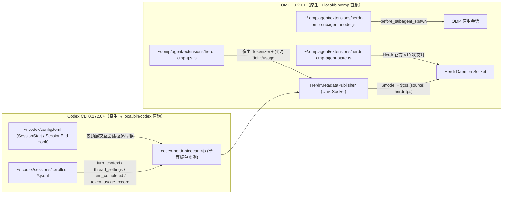

# 自定义扩展彻底精简与去代理化优化计划

- **日期**：2026-11-25
- **范围**：`integrations/herdr-tps/`、宿主机 CLI/Shell/Hook 接线、`crates/herdr-usage` 单 Key 归因衔接、`integrations/codex-chatgpt-web-local` 外围状态与仓库文档一致性
- **状态**：已实施并完成带备份的宿主机切换；新 Codex TUI 首次启动仍需用户通过原生 Hook 信任提示

---

## 1. 背景与目标

当前仓库围绕本地 Agent 运行环境积累了两套自定义扩展体系：

1. **`integrations/herdr-tps`**：早期为了在 Herdr 侧栏展示 `$model`/`$tps`、维持多号 `opencode-go` 会话粘性、共享 `omp2` (`pro2`) 守护进程以及近期约束 OMP 子代理默认模型，演化出了**双 CLI 启动包装器（`omp-with-tps.mjs` + `codex-with-tps.mjs`）+ `.runtime/omp` 303MB 二进制拷贝 + Codex 实验性 `app-server`/WebSocket 中间人代理 + `.bashrc` PATH 劫持**的重型结构。
2. **`integrations/codex-chatgpt-web-local`**：针对 `miuuyy/codex-chatgpt-web`（当前 `v6.2.0`）维护 Native2 真实代码块传输与原始 JSON 直出的本地源码补丁与重打包流程。

结合实机审计结论与最新使用约束（**后续仅使用单 `opencode-go` Key，且不再使用 `omp2` / `pro2` profile**），本计划采用**彻底根治方案**而非局部打补丁止血：

- **彻底废除全部 CLI 启动包装器与 WebSocket 中间人代理**，让 `omp` 与 `codex` 100% 回归官方原生二进制直跑；
- **彻底下线 `opencode-go` 会话粘性扩展与 `omp2` 专属逻辑**，清理 `.bashrc` 全部受管注入块；
- **OMP 侧改走 `~/.omp/agent/extensions/` 原生自动发现**，将“子代理模型继承”与“Herdr 侧栏上报”拆分为职责正交、故障隔离的两个轻量扩展；
- **Codex 侧改走原生 `SessionStart`/`SessionEnd` Hook + 单实例 Rollout 日志旁路观察器（Sidecar）**，以服务端权威 `token_usage_record` 替代实验性 `--remote` 代理与 `gpt-tokenizer` 估算；
- **清空根仓库全部外部 npm 依赖（`ws`、`gpt-tokenizer`、`node_modules`、`package-lock.json`）**，100% 基于 Node.js 22 内置模块运行。

### 优化前后核心指标对比

| 维度 | 当前状态 | 目标终态 |
| :--- | :--- | :--- |
| **CLI 劫持包装脚本** | `omp-with-tps.mjs` + `codex-with-tps.mjs`（2 个） | **0 个**（`~/.local/bin/omp` 与 `codex` 均为原生入口） |
| **`~/.bashrc` 注入块** | `omp2` 函数块 + `herdr-tps Herdr-only PATH` 块（2 处） | **0 处** |
| **Codex 单面板附加进程** | Node WS 代理 + `codex app-server`（+2 重型进程，`--remote` 模式） | **1 个纯只读文件观察小进程**（无端口监听、无 `--remote` 限制） |
| **二进制冗余拷贝** | `integrations/herdr-tps/.runtime/omp`（**303 MB**） | **0 MB**（迁回 `~/.local/bin/omp` 原位，原生支持 `omp update`） |
| **外部 npm 依赖** | `ws`、`gpt-tokenizer`、`node_modules`、`package-lock.json` | **0 个外部依赖**（纯 Node 22 标准库 + OMP 宿主内置 `Tokenizer`） |
| **CLI 参数冲突与嵌套误伤** | `omp --no-tools` 报错退出；Herdr 内 `codex review`/`exec` 报错且清空父面板侧栏 | **彻底根除** |
| **OMP 升级人工仪式** | `OMP-SESSION-ROUTING.md`（3,512 行）+ `grep -ao` 数二进制符号频次 | **废除**，仅运行自动化单元与轻量契约测试 |

---

## 2. 模块裁撤与终态架构设计

### 2.1 板块一：彻底下线项（零残留退役）

#### 1) 下线 `opencode-go` 会话粘性路由扩展
- **事实依据**：本机后续只保留单个 `opencode-go` API Key；实测 OMP `19.2.0` 的 `CredentialSelector.selectApiKey` 在可用池长度为 `1` 时直接执行 `if (l.length === 1) return l[0]`，天然无每次请求重排开销。
- **代码清理**：
  - 删除 `integrations/herdr-tps/lib/omp-api-key-observer.mjs`；
  - 删除 `integrations/herdr-tps/test/omp-api-key-observer.test.mjs`；
  - 删除 `integrations/herdr-tps/OMP-SESSION-ROUTING.md`（3,512 行）、`.agents/commands/omp-upgrade.md`、`.codex/commands/omp-upgrade.md`。
- **`crates/herdr-usage` 最小无损衔接**（遵守 `AGENTS.md` 不重写其他模块的原则）：
  - **保留历史兼容**：保留 `crates/herdr-usage/src/sources/omp_api_keys.rs` 对既有日志中 `herdr-api-key-sticky-v1` 的只读解析能力，确保历史已落盘会话重放或对账不丢账户标签。
  - **恢复单 Key 原生自动归因并规避损坏 `cache` 表**：
    - 实机复核确认 `~/.omp/agent/agent.db` 的 `auth_credentials` 表中 `opencode-go` 当前确仅有 `1` 条启用记录，但同库的 `cache` 表存在 SQLite 页损坏（`database disk image is malformed`）。
    - 修改 `crates/herdr-usage/src/sources/omp.rs` 的 `AccountCatalog::load` 与 `resolve`：① 查询 `auth_credentials` 时补充 `AND (disabled_cause IS NULL OR disabled_cause = '')` 过滤已禁用旧凭据；② 移除 `if provider != "opencode-go"` 与 `if provider == "opencode-go" { return None; }` 两处人工封锁；③ 移除对 `agent.db` 中 `cache` 表 `session:sticky:opencode-go:%` 的冗余扫描（彻底避开损坏页）。此后单 Key 场景直接走健康的 `auth_credentials` $\rightarrow$ `single_credential` 自动归因，零 JS 扩展介入。

#### 2) 下线 `omp2` (`pro2` profile) 全部定制逻辑
- **仓库清理**：
  - 删除 `integrations/herdr-tps/share-omp-daemons.mjs`、`integrations/herdr-tps/test/share-omp-daemons.test.mjs`；
  - 删除 `integrations/herdr-tps/lib/omp-profile.mjs`；
  - 从 `HerdrMetadataPublisher`、`LiveTpsReporter` 及 OMP 扩展中删除全部 `display_agent`、`setDisplayAgent`、`refreshDisplayAgent`、`displayRefreshTimer`、`appliesToSource` 相关逻辑与测试（默认 `omp` 与 `codex` 由 Herdr 原生显示 Agent 名称，无需 `display_agent` 覆盖）。
- **宿主机清理**：
  - 从 `~/.bashrc` 移除 `# >>> omp profile alias: omp2 >>> ... # <<< omp profile alias: omp2 <<<` 受管函数块；
  - 移除 `~/.omp/profiles/pro2/agent/extensions/herdr-omp-agent-state.ts` 软链（保留 `~/.omp/profiles/pro2/agent/sessions/` 历史会话文件不动，防止误删历史记录）。

---

### 2.2 板块二：OMP 扩展无包装化与职责解耦

#### 1) 废除 `omp-with-tps.mjs` 与 `.runtime/omp`，回归原生二进制
- **实测加载契约（关键陷阱规避）**：
  - 经实机沙箱验证，OMP `19.2.0` 的 `~/.omp/agent/extensions/` 自动发现器**仅加载 `.ts` 与 `.js` 文件（支持符号链接），会静默忽略 `.mjs` 后缀文件**！
  - 同时实测确认：当扩展位于 `~/.omp/agent/extensions/*.js`（或 `.ts`）自动发现加载时，运行 `omp --no-tools ...` 或 `omp --mode rpc --no-tools ...` **退出码为 `0`（原生自动按规则跳过用户扩展，不报错）**，彻底解决了当前 `omp-with-tps.mjs` 硬塞 `--extension` 导致 `--no-tools` 与 `--trusted-extension` 全局崩溃的问题。
- **二进制安全迁回约束**：
  - 当前本机唯一的 `omp 19.2.0` ELF 可执行文件位于 `integrations/herdr-tps/.runtime/omp`（`~/.local/bin/omp` 是指向 `omp-with-tps.mjs` 的软链，`.herdr-omp-original` 是指向 `.runtime/omp` 的软链）。
  - **严格顺序**：必须先校验 `.runtime/omp` 非 Node 脚本且可执行，将其原子复制至 `~/.local/bin/omp.tmp` 并 `rename` 覆盖 `~/.local/bin/omp`（`0755`），实测 `~/.local/bin/omp --version` 输出 `omp/19.2.0` 后，方可删除 `.herdr-omp-original`、`omp-tps` 与 `integrations/herdr-tps/.runtime/`。此后 `omp update` 直接原位增量更新 `~/.local/bin/omp`。

#### 2) 拆分为两个故障隔离的原生扩展（`.js` 入口软链至 `~/.omp/agent/extensions/`）
仓库内保留标准 ESM（根 `package.json` 已声明 `"type": "module"`，因此仓库内 `.js` 即为原生 ESM，既可被 Node 22 `node --test` 直接导入，也可通过软链被 OMP `~/.omp/agent/extensions/*.js` 原生识别）：

1. **`integrations/herdr-tps/omp-subagent-model.js`（子代理默认跟随父模型）**
   - **职责单一**：仅注册 `before_subagent_spawn`，与 Herdr 是否运行、是否有 TUI 完全解耦。
   - **防御性导入与空值加固**：
     - 将 `import('@oh-my-pi/pi-coding-agent/config/registry')` 与 `import('@oh-my-pi/pi-catalog/models')` 包裹在 `try/catch` 中；若未来 OMP 调整内部模块路径，仅记录一次 `pi?.logger?.warn?.(...)` 并优雅退回原生行为，绝不炸毁会话或连坐 TPS 扩展；
     - 使用安全链读取配置：`const overrides = agentModelOverrides?.get?.(settings); const override = overrides?.[event.agent];`；
     - **修复 `eval` 显式按次角色误覆盖问题**：在模块初始化时通过只读方式缓存内置/用户 Agent 定义自身的默认角色表（或仅当 `event.invocationKind !== 'eval'`，或核对目标 Agent 定义本身的 `model` 属性确为 `@${event.modelRole}` 时才替换），避免用户在 `eval` 中显式调用 `agent({ agent: "m1", model: "@slow" })` 时被误判为默认未配置角色而强行改成父模型。
2. **`integrations/herdr-tps/omp-herdr-tps.js`（Herdr 侧栏 `$model` / `$tps` 上报）**
   - **零私有路径依赖**：仅在 `publisher.enabled === true` 时动态 `import('@oh-my-pi/pi-agent-core')` 获取公开导出的 `Tokenizer`；非 Herdr 环境加载开销趋近于零。
   - **无 Wrapper 嵌套自保护**：
     - 模块加载时判定：`const top = process.env.HERDR_TPS_OMP_TOPLEVEL; const isNested = process.env.OMPCODE === '1' || Boolean(top && top !== String(process.pid));`
     - 当顶层根 UI 会话首次激活（`ensureRootSession` 通过 `context?.agent?.kind !== 'sub' && context?.hasUI === true`）时，在当前进程环境设置 `process.env.HERDR_TPS_OMP_TOPLEVEL = String(process.pid)`。如此即便父 OMP 不经 shell（无 `OMPCODE=1`）直接 `spawn('omp')`，子进程也会继承 `HERDR_TPS_OMP_TOPLEVEL=<父 PID>` 并自动禁用 metadata 上报，完全替代原 `omp-with-tps.mjs` 的环境变量剥离职责。

---

### 2.3 板块三：Codex 彻底去代理化——原生 Hook + 单实例 Rollout 旁路观察器

#### 1) 废除实验性 `app-server` + WebSocket 中间人代理 + `--remote`
- 删除 `integrations/herdr-tps/codex-with-tps.mjs`、`lib/codex-tps-observer.mjs`、`lib/model-token-counter.mjs` 及对应测试（`codex-tps-observer.test.mjs`、`codex-wrapper.e2e.test.mjs`、`model-token-counter.test.mjs`）；
- 清理宿主机 `~/.local/share/herdr-tps/bin/codex`、`~/.local/bin/codex-tps`、`~/.local/bin/.herdr-codex-original`，以及 `~/.bashrc` 中的 `# >>> herdr-tps Herdr-only PATH >>> ... # <<< herdr-tps Herdr-only PATH <<<`；
- `~/.local/bin/codex` 保持官方 standalone 软链直通，所有子命令（`codex review`、`codex exec`、`codex mcp`、`codex doctor`、`-c`、`-m`）100% 原生工作。

#### 2) 新建 `integrations/herdr-tps/codex-herdr-hook.js` 与 `codex-herdr-sidecar.js`
利用 Codex CLI `0.172.0` 已启用的原生 Hooks 机制（在 `~/.codex/config.toml` 末尾以独立 `[[hooks.SessionStart]]` 与 `[[hooks.SessionEnd]]` 分组追加条目，**不修改** Herdr 官方受管的 `~/.codex/herdr-agent-state.sh`）：

- **零绕过合规接入与防阻塞启动约束（复核新增硬规则）**：
  1. **保护既有 Hook 信任索引并走原生确认**：`~/.codex/config.toml` 通过 `[hooks.state."<file>:<event>:<group_idx>:<hook_idx>"]` 与 `~/.codex/.hook-trust` 校验 Hook 信任状态（当前 `session_start:0:0` 已被官方 `herdr-agent-state.sh` 占用）。安装器**必须以独立新分组（`session_start:1:0` 与 `session_end:0:0`）追加在既有 `[[hooks.SessionStart]]` 之后**，严禁插入到首位破坏 `:0:0` 索引，且**严禁伪造或写入 `[hooks.state]` / `.hook-trust`**；安装完成后由用户在首次打开交互 `codex` 时通过 Codex 原生信任提示确认一次即可。
  2. **彻底关闭继承管道防 TUI 卡顿**：Codex 执行 Hook 时会等待子进程 `stdout`/`stderr` 管道 EOF。`codex-herdr-hook.js` 拉起后台 `codex-herdr-sidecar.js` 时**必须使用 `spawn(process.execPath, [sidecarPath, stateFile], { detached: true, stdio: 'ignore' })` 并立即 `child.unref()` + `process.exit(0)`**，确保 Hook 在 `<30ms` 内返回且不向孙进程泄漏任何管道文件描述符。

- **第一重防线：严格根交互会话门禁（彻底杜绝嵌套与非交互污染）**
  Hook 脚本仅在同时满足以下全部条件时才工作，任一不满足立即 `exit 0`：
  1. `HERDR_ENV === '1'` 且 `HERDR_PANE_ID`、`HERDR_SOCKET_PATH` 非空；
  2. `OMPCODE !== '1'` 且 `!process.env.HERDR_TPS_OMP_TOPLEVEL`（排除在 OMP 面板子 shell 中调用的 `codex review`/`exec`）；
  3. `!process.env.CODEX_THREAD_ID || process.env.CODEX_THREAD_ID === hookInput.session_id`（与官方 `herdr-agent-state.sh` 一致，排除 Codex 派生的子代理会话）；
  4. `hookInput.transcript_path` 为存在的绝对路径，且通过 `/proc` 祖先链可定位到持有同一 `HERDR_PANE_ID` 的交互式顶层 `codex` 宿主进程（非 `codex exec` / `codex review` 一次性批处理子命令——批处理模式下亦可通过检查祖先 `codex` 的 `/proc/<pid>/cmdline` 排除含 `exec`、`e`、`review`、`app-server`、`mcp` 等非 TUI 子命令！）。

- **第二重防线：单面板单实例状态机与零孤儿生命周期**
  1. 同步 Hook 解析顶层交互 `codex` 祖先的 `pid` 与 `/proc/<pid>/stat` 第 22 字段 `starttime`（构成防复用身份 `pid:starttime`）；
  2. 状态文件位于 `${XDG_RUNTIME_DIR:-/run/user/$UID}/herdr-tps/codex-${sha256(HERDR_PANE_ID).slice(0,16)}.json`（权限 `0600`），记录 `{ paneId, codexPid, codexStartTime, sessionId, transcriptPath, sidecarPid, updatedAt }`；
  3. **会话热切换**：当用户在同一个 `codex` TUI 内执行 `/resume` 或切换会话再次触发 `SessionStart` 时，若原 `sidecarPid` 仍存活且绑定同一 `codexPid:codexStartTime`，Hook 只原子更新状态文件并向 `sidecarPid` 发送 `SIGUSR1` 立即唤醒重读状态——**不重复拉起新进程**；
  4. **双路径退出清理**：
     - 正常退出：`[[hooks.SessionEnd]]` 匹配当前 `sessionId` 时通知 sidecar 执行 `publisher.clearAll()` 并退出，删除状态文件；
     - 异常强杀兜底：sidecar 每 `1000ms` 检查 `/proc/<codexPid>/stat` 的 `starttime` 是否仍匹配；一旦宿主 `codex` 消失（含 `SIGKILL`、终端关闭），`1s` 内自动 `clearAll()` 并退出；若 sidecar 自身也被强杀，Herdr 侧 `5000ms` TTL 自动过期清尾。

- **第三重设计：精确 `$model` 与权威 `$tps` 采集口径**
  经实机核验 Codex `0.172.0` 的 `rollout-*.jsonl` 实时刷盘时间线，单轮推理过程中每个 `Reasoning`、`AgentMessage`、`CommandExecution` 与 `token_usage_record` 均按秒级实时落盘：
  1. **`$model` 零延迟初始化与实时跟随**：
     - **解决新开空 TUI 时 `rollout-*.jsonl` 初始为 `0` 字节的问题**：Sidecar 启动时优先读取 `hookInput.model`；若无，则只读解析 `~/.codex/config.toml` 顶层 `model`（及 `model_reasoning_effort` 无关项忽略）先发布初始模型名；
     - 随后增量监听 `rollout-*.jsonl`：遇到 `turn_context`（取 `payload.collaboration_mode?.settings?.model ?? payload.model`）或 `event_msg:thread_settings_applied`（取 `payload.thread_settings?.collaboration_mode?.settings?.model ?? payload.thread_settings?.model`）立即刷新 `$model`。
  2. **`$tps` 服务端权威口径（消除 `gpt-6` 盲猜与外部依赖）**：
     - 增量读取器带**半行残留保护**（未遇到 `\n` 的尾部半行暂存至下次读取，绝不丢弃或报错）；
     - 记录当前推理步内首个生成项（`event_msg:item_completed` 中 `item.type` 为 `Reasoning` 或 `AgentMessage`）的 `started_at_ms` 与最新 `completed_at_ms`；
     - 当收到对应的 `token_usage_record`（含服务端权威 `payload.usage.output_tokens`，完整覆盖可见文本与加密/摘要推理 token）时，以 `(output_tokens, completed_at_ms - step_started_at_ms)`（无 item 时间戳时回退请求间隔或 `task_complete.duration_ms`）输入既有 `TokenRateMeter` 计算并发布保留一位小数的 `$tps`；
     - **口径折衷说明**：相比旧方案每 250ms 用 `UTF-8 字节 / 4` 估算可见字符跳动，新方案改为**每个推理步/工具步（实测间隔约 2～8 秒）以服务端真实账单 output tokens 刷新速率**。略微牺牲单段长回复中途前几秒的帧级跳动感，换取 **GPT-6 系列 100% 精确 token 计数、包含隐藏推理吞吐、零 WebSocket 代理故障面与零 npm 依赖**。

---

### 2.4 板块四：清空 npm 依赖、`codex-chatgpt-web-local` 外围清理与文档对齐

1. **根 `package.json` 零依赖化**：
   - 移除 `dependencies` 中的 `"gpt-tokenizer"` 与 `"ws"`；
   - 删除根目录 `package-lock.json` 与 `node_modules/`；
   - 更新 `package.json` 的 `scripts` 为：
     - `"herdr:tps:install": "node integrations/herdr-tps/install.mjs"`
     - `"herdr:tps:uninstall": "node integrations/herdr-tps/install.mjs --uninstall"`
     - `"herdr:tps:test": "node --test integrations/herdr-tps/test/*.test.mjs"`
   - 更新根目录 `install.sh` 与 `README.md`（不再需要 `npm ci`）。
2. **`integrations/codex-chatgpt-web-local` 外围收口**（核心补丁 `local-fixes.patch` 与 `upgrade.mjs` 保持不动）：
   - `review-smoke.mjs`：在 Codex `--remote` 包装器退役后，将默认 `CODEX_BIN` 简化为标准 `codex`（若环境中残留 `.herdr-codex-original` 仅作可选兼容或直接移除特判，保留 `process.env.CODEX_BIN` 覆盖）；
   - `verification.json`：移除顶层已过期的 `stagedUpgrade`（`awaiting-user-restart`）残留块，保留当前 `installed-and-verified`（`v6.2.0`、`bundleId=db3cbf7d…e89f`）权威凭据，并将 4 层递归嵌套的 `previousInstalled` 收敛为扁平的 `history` 摘要列表（最多保留最近 2 次版本记录）。
3. **跨文档冲突修复**：
   - 根目录 `README.md` §5：删除过时的 `6.1.19` 与会破坏本地补丁的官方 `install-launcher.sh` 命令，改为指向 `integrations/codex-chatgpt-web-local/README.md` 的 `upgrade.mjs status / stage / finalize` 流程；
   - 根目录 `README.md` 第 120 行与 `integrations/herdr-tps/MAINTENANCE.md` 回归清单第 547 行：修正为与 `crates/herdr-usage` 实际实现一致的口径——**“优先采集 `token_usage_record`，同文件一旦出现 `token_usage_record` 自动忽略 `token_count`；仅无 `token_usage_record` 的旧日志回退 `token_count`”**。

---

## 3. 文件级变更清单（一目了然）

### 3.1 计划删除的文件与宿主机条目
- **仓库文件删除**：
  - `integrations/herdr-tps/omp-with-tps.mjs`
  - `integrations/herdr-tps/codex-with-tps.mjs`
  - `integrations/herdr-tps/omp-extension.mjs`（拆分为下列两个独立 `.js` 扩展）
  - `integrations/herdr-tps/share-omp-daemons.mjs`
  - `integrations/herdr-tps/lib/omp-api-key-observer.mjs`
  - `integrations/herdr-tps/lib/omp-profile.mjs`
  - `integrations/herdr-tps/lib/codex-tps-observer.mjs`
  - `integrations/herdr-tps/lib/model-token-counter.mjs`
  - `integrations/herdr-tps/OMP-SESSION-ROUTING.md`
  - `integrations/herdr-tps/test/omp-api-key-observer.test.mjs`
  - `integrations/herdr-tps/test/omp-wrapper.test.mjs`
  - `integrations/herdr-tps/test/share-omp-daemons.test.mjs`
  - `integrations/herdr-tps/test/codex-tps-observer.test.mjs`
  - `integrations/herdr-tps/test/codex-wrapper.e2e.test.mjs`
  - `integrations/herdr-tps/test/model-token-counter.test.mjs`
  - `.agents/commands/omp-upgrade.md`
  - `.codex/commands/omp-upgrade.md`
  - `package-lock.json`（及未跟踪的 `node_modules/`、`integrations/herdr-tps/.runtime/`）
- **宿主机状态清理（由新版 `install.mjs` 自动幂等迁移并备份）**：
  - 迁回实体二进制：`integrations/herdr-tps/.runtime/omp` $\rightarrow$ `~/.local/bin/omp`
  - 删除软链：`~/.local/bin/.herdr-omp-original`、`~/.local/bin/omp-tps`、`~/.local/bin/.herdr-codex-original`、`~/.local/bin/codex-tps`、`~/.local/share/herdr-tps/bin/codex`（及空目录）
  - 删除 `~/.bashrc` 两处受管块：`omp2` alias 块、`herdr-tps Herdr-only PATH` 块
  - 删除 `~/.omp/profiles/pro2/agent/extensions/herdr-omp-agent-state.ts` 软链

### 3.2 计划新增与精简重构的文件
- **新增**：
  - `integrations/herdr-tps/omp-subagent-model.js`（软链至 `~/.omp/agent/extensions/herdr-omp-subagent-model.js`）
  - `integrations/herdr-tps/omp-herdr-tps.js`（软链至 `~/.omp/agent/extensions/herdr-omp-tps.js`）
  - `integrations/herdr-tps/codex-herdr-hook.js`（接入 `~/.codex/config.toml` 的 `SessionStart` / `SessionEnd`）
  - `integrations/herdr-tps/codex-herdr-sidecar.js`（单面板单实例 Rollout 观察器）
  - `integrations/herdr-tps/lib/codex-rollout-follower.mjs`（带半行保护与权威 usage/时间戳解析的纯函数模块）
  - 对应单元测试：`test/omp-subagent-model.test.mjs`、`test/omp-herdr-tps.test.mjs`、`test/codex-rollout-follower.test.mjs`、`test/codex-herdr-sidecar.test.mjs`
- **精简重构**：
  - `integrations/herdr-tps/lib/herdr-metadata-publisher.mjs`（移除 `display_agent` / `appliesToSource` 死分支，统一 `OMPCODE` / `HERDR_TPS_OMP_TOPLEVEL` / `CODEX_THREAD_ID` 防护）
  - `integrations/herdr-tps/lib/live-tps-reporter.mjs` & `omp-tps-reporter.mjs` & `token-rate-meter.mjs`（移除 `displayAgent` 与 `model-token-counter` 依赖，保留纯数学速率计与心跳/TTL 刷新）
  - `integrations/herdr-tps/install.mjs`（重构为：二进制安全归位 + `~/.omp/agent/extensions/*.js` 软链安装 + `~/.codex/config.toml` Hook 幂等注入 + `~/.bashrc` 旧块迁移清理 + `--dry-run` / `--uninstall` 支持）
  - `crates/herdr-usage/src/sources/omp.rs`（放开 `opencode-go` 的 `single_credential` 自动归因限制，补 1 条单测）
  - 文档与凭据同步：`AGENTS.md`（移除第 15 行 `.herdr-codex-original` 旧说明）、`README.md`、`integrations/herdr-tps/README.md`、`integrations/herdr-tps/MAINTENANCE.md`、`integrations/codex-chatgpt-web-local/README.md`（同步第 159 行 CLI 默认入口说明）、`integrations/codex-chatgpt-web-local/review-smoke.mjs`、`integrations/codex-chatgpt-web-local/verification.json`

---

## 4. 分阶段安全实施路线与回滚方案

遵循“**先建新路与测试，再做带备份的宿主机原子切换，最后删旧壳**”的顺序，防止中途断路：

### Phase 1：新模块实现与离线单测全绿（零宿主机改动）
1. 编写 `omp-subagent-model.js`、`omp-herdr-tps.js`、`codex-rollout-follower.mjs`、`codex-herdr-hook.js`、`codex-herdr-sidecar.js`，精简 `herdr-metadata-publisher.mjs` 与 `live-tps-reporter.mjs`。
2. 在隔离临时目录（临时 `HOME`、临时 Unix Socket、模拟 `rollout.jsonl` 半行追加与进程退出、本机 OMP `19.2.0` 真实自动发现探针）跑通全部 `node --test`。

### Phase 2：`crates/herdr-usage` 单 Key 归因放开与 Rust 回归
1. 修改 `crates/herdr-usage/src/sources/omp.rs` 放开 `opencode-go` 的 `single_credential` 收集与解析，保留 `omp_api_keys.rs` 历史条目兼容。
2. 运行 `cargo test --offline --locked`，确保 `ai-monitor` 与 `herdr-usage` 全量测试 100% 通过。

### Phase 3：重构安装器并执行 `--dry-run` 预检
1. 完成新版 `integrations/herdr-tps/install.mjs`（含 `~/.bashrc`、`~/.codex/config.toml`、`~/.config/herdr/config.toml` 时间戳备份与 TOML/语法校验失败自动回滚）。
2. 运行 `node integrations/herdr-tps/install.mjs --dry-run`，逐项核对待迁回的 `omp` 二进制路径、待清理软链、待移除 `.bashrc` 块与待写入 Codex Hook。

### Phase 4：宿主机原子切换（不影响已打开的运行中会话）
1. 执行 `node integrations/herdr-tps/install.mjs`：
   - 校验并将 `.runtime/omp` 原子归位至 `~/.local/bin/omp`（已运行中的 OMP 进程持有原 inode，不受影响）；
   - 建立 `~/.omp/agent/extensions/herdr-omp-subagent-model.js` 与 `herdr-omp-tps.js` 软链；
   - 备份并幂等更新 `~/.codex/config.toml` 的 `SessionStart` / `SessionEnd` Hook；
   - 备份并清理 `~/.bashrc` 的 `omp2` 与 `herdr-tps PATH` 块，移除废弃软链。
2. 实机烟雾核验：
   - `which omp && omp --version && omp --no-tools --version` 均正常输出 `19.2.0`；
   - `HERDR_ENV=1 bash -ic 'command -v codex'` 命中原生 `~/.local/bin/codex`；
   - 在模拟 `HERDR_ENV=1` 下执行 `codex review --help` 原生通过，不再触发 `--remote` 报错。

### Phase 5：旧文件移除、零依赖收口与文档清理
1. 删除 §3.1 所列废弃源码、测试、`.runtime/`、`package-lock.json`、`node_modules/`，清空 `package.json` 外部 `dependencies`。
2. 更新 `README.md`、`MAINTENANCE.md`、`review-smoke.mjs`、`verification.json`。
3. 最终全套验证：`npm run herdr:tps:test`、`node integrations/herdr-tps/install.mjs --dry-run`、`node --test integrations/codex-chatgpt-web-local/upgrade.test.mjs`、`cargo test --offline --locked`、`git diff --check`。

### 回滚预案
- 宿主机所有被修改文件（`~/.bashrc`、`~/.codex/config.toml`、`~/.config/herdr/config.toml`）均在同目录保留 `.bak-herdr-tps-<timestamp>` 备份；
- 新版 `install.mjs --uninstall` 可一键移除 `~/.omp/agent/extensions/herdr-omp-*.js` 软链与 `~/.codex/config.toml` 中的受管 Hook 条目，同时完整保留 `~/.local/bin/omp` 与 `~/.local/bin/codex` 原生可执行文件可用。

## 5. 实施记录（2026-11-25）

- 已拆分 OMP 原生 `.js` 扩展，保留 task 默认继承、显式 eval 选择与 TPS 故障隔离。
- 已安装 Codex 原生 Hooks 与每面板只读 Rollout 观察器；不修改 Hook 信任状态、不重启现有会话。
- 已原子归位 OMP 19.2.0，迁移前后二进制 SHA-256 相同：`74cb641d3fcdc22fa3f2141dafa4e66c9fc581d7d2d71753e690160980472c31`。
- 已移除旧 wrappers、代理、会话粘性扩展、omp2 接线、npm 外部依赖及冗余 Runtime。pro2 历史会话保留。
- 已恢复单 Key 自动归因、过滤禁用凭据并避开 cache 表，同时保留旧 schema 与历史 pin 兼容；历史对账保留已采集的 single_credential。
- `review-smoke.mjs` 改用标准 codex；Web GPT 实际状态仍匹配 v6.2.0 的既有 receipt 与 bundle，不涉及重建、安装或重启。
- 宿主机本次备份后缀：`.bak-herdr-tps-1795612511072-1561677`。首次运行前的仓库未提交修改另有完整备份；不提交配置、原始日志或真实 token。

首次在新 Codex TUI 中接受原生 Hook 信任提示后，才具备真实面板展示验收条件。自动测试与无模型调用的 CLI 烟雾不替代这项用户界面确认。

最终验证结果：

- `npm run herdr:tps:test`：70 通过，0 失败、0 跳过，含 OMP 19.2.0 真实自动发现及正常/异常 SessionEnd 生命周期。
- `cargo test --offline --locked`：317 通过，0 失败，1 项仓库原有 ignored。
- `node --test integrations/codex-chatgpt-web-local/upgrade.test.mjs`：13 通过。
- 重复 `install.mjs --dry-run` 无待变更项，原有 Hook 信任状态与 SessionStart 首组逐项保持一致。
- OMP 版本/无工具参数与 Herdr Shell 下原生 Codex review 帮助命令通过；Web GPT `status` 为健康并匹配原 receipt。
- 本次修改的差异空白检查通过。全仓 `git diff --check` 仍报告此前已有的 `local-fixes.patch:346` 尾随空白；核心补丁保持原哈希，未修改该行。
- 实施前仓库修改备份：`~/.local/state/ai-monitor/custom-extensions-before-20261125/`（含原始差异及被退役源码；不保留冗余 OMP 二进制）。

## 6. 五项复核与后续修正（2026-11-25）

1. 生产部署：已执行 `cargo build --release --locked --offline -p herdr-usage`、备份旧采集器、原子安装并明确重启 `herdr-usage-collector`。新 PID `1599293`（21:37:40 CST），Release、安装文件与 `/proc/<pid>/exe` SHA-256 均为 `6f461badcb224795fe56e64d0c46550252b8b96bda51b061a4c048609eff14e1`。日志确认完成首轮采集。旧二进制备份：`~/.local/state/ai-monitor/herdr-usage-before-20261125/herdr-usage`。`install.sh` 的采集器安装也已改为临时文件加 rename。此次只更新采集器，未重新安装其他模块或重启 Codex Web GPT。
2. eval：初始化时使用 OMP 原生 discovery 读取实际 Agent 定义，按唯一默认角色匹配，而非一律排除 eval。reviewer/scout 默认继承，m1、未知 Agent、不同默认角色和配置覆盖保留。实机定义 model 为数组，回归覆盖其实际结构。事件未包含显式参数来源，同一个内置 Agent 显式指定与定义相同的角色仍不可区分，按默认角色处理；不声称完全识别所有显式参数。
3. 热重载：OMP 根标记改为 PID，Publisher 与入口允许同 PID，跨 PID 和任意非空 OMP 标记下的 Codex Hook 被拦截。旧会话若仍保留标记 `1`，正常退出重开一次后使用新规则。
4. Sidecar：切换时先清场，单 tick 合并历史发布，权威样本累加指数衰减历史桶，文件截断重置解析器与去重；已补充 nvm Node 卸载/切换后重新安装 Hook 的维护说明。
5. 卫生：5 个受管悬空备份（含隐藏原二进制软链与 dispatcher 备份）已移出 PATH，保留在 `~/.local/state/herdr-tps/backups/1795613957993-1600993/`；空的旧 dispatcher bin 已删除。三个策略测试移至对应策略测试文件，TPS 旧标题及 displayAgent 测试桩已清理。

本轮验证：JS 76 项通过（0 跳过，含本机 OMP 自动发现、默认 eval 与 PID 热重载契约）；Rust 采集器 143 项通过；Shell 语法与安装器重复 dry-run 通过。没有生成真实模型请求。

实际 Release 隔离烟雾也通过：使用临时 HOME、仅 auth_credentials 的单 Key 数据库（完全没有 cache 表）、原生无 pin 的新 OMP 请求，由常驻 Release 采集器实际落库为非空 account_key 与 single_credential。测试进程正常退出，生产服务仍为 active。
