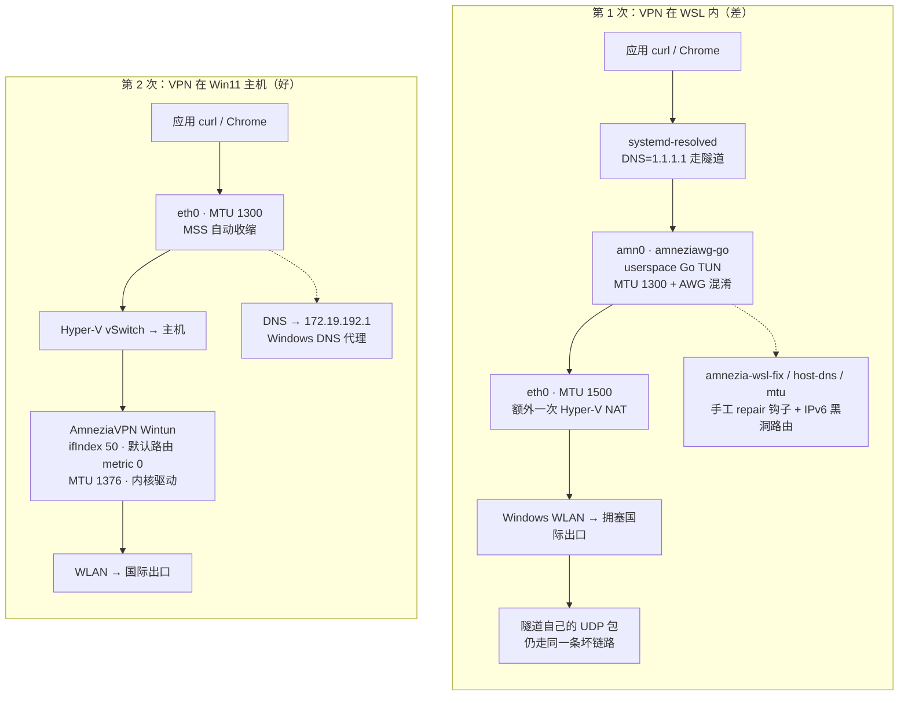

# AI 线路延迟与丢包：调查记录与根因

日期：2026-11-14
范围：本机 WSL2 + Windows 11 主机网络路径、`ai-monitor` 线路探测、Codex 真实调用链
状态：**调查完成，未修改任何配置**；§7 残留风险与建议待执行

---

## 1. 结论摘要

用户现象：AI 线路面板连通率 76.7%–83.3%，Codex 偶发中断连接、建连 1500–2000ms。

三个结论：

1. **面板测不出"哪一段丢包"。** `100% − 连通率` 是探测失败率，不是丢包率；TCP 重传会掩盖真实丢包，DNS/TLS 错误也会导致探测失败（`crates/ai-monitor/README.md:265`）。面板只是"丢包驱动超时"的结果，不是原因。
2. **丢包集中在 Windows 主机之后的 ISP 国际出口，慢在 TCP/TLS 握手段，不在服务端响应。** 内核计数 `TCPSynRetrans=37124`、`TCPTimeouts=42440` 与 12 次连接中 2 次 `tcp=1.16/1.18s` 是同一现象（SYN RTO≈1s）。
3. **两次测量差距的根因，不是"同一 VPN 的两种开法"，而是两条完全不同的数据路径。** 用户确认：第 1 次 VPN 开在 WSL 内，第 2 次开在 Win11 主机。WSL 内开是把一条 userspace UDP 加密隧道叠在已拥塞的出口之上，并附带一整套手工兼容钩子；主机开是内核 Wintun 驱动接管默认路由并做 MSS clamp，WSL 只交出普通 TCP 帧。

| | 第 1 次：VPN 在 WSL 内 | 第 2 次：VPN 在 Win11 主机 |
|---|---|---|
| 丢包 | 20–33% | 0–3.3% |
| RTT 均值 | 160–162ms | 87–97ms |
| 面板「建连」 | 0.52–1.89s，常见 1.5–2s | 0.17–0.22s |
| 受控窗口 `RetransSegs` 增量 | 累计 54315（持续增长） | **+0**（98 次新建连接） |

---

## 2. 面板语义（避免误读）

`crates/ai-monitor/src/network.rs` 与 `crates/ai-monitor/README.md:245-265`：

- 「建连」= `%{time_appconnect}`，即 DNS + TCP + TLS 累计；「响应」= `%{time_starttransfer}`，含建连、是累计值，**不是服务端处理时间**（`network.rs:179`、README:257-258）。
- `超时` + `—` = curl 未在 `--max-time 5` 内完成（`network.rs:168`），或 `execute` 的硬超时 `timeout=MIN_INTERVAL=5s`（`network.rs:338`）。**不是某段丢包的读数**。
- 探测为 `--disable` 的无凭据 HEAD、无代理（`network.rs:163-182`）；`ai-monitor`(pid 11265) 与各 `omp` 进程 environ 均无 `*_PROXY`，系统 `ProxyEnable=0`，注册表遗留 `127.0.0.1:1080` 实测未监听。
- `WINDOW = 300s`（`network.rs:27`）：网络恢复后面板旧失败样本最多还要挂 5 分钟才会被 `rate()` 冲掉，**瞬时面板数字不等于当前网络**。

按 10s×30 次=30 样本，76.7%≈7 次失败、83.3%≈5 次失败，与实测 20–33% 丢包、5s 预算只能吸收 2–3 次 1s RTO 重传吻合。

### 两个会误导判断的发现

- **运行的是旧二进制**：`~/.local/bin/ai-monitor`（2026-10-30 构建）含 4 条线路（含 Antigravity）；当前源码 `network.rs:16` 已是 3 条，commit `599e287` 删除了 Antigravity。截图里第 4 行来自旧版。
- **`.wslconfig`**：`autoProxy=false`、`dnsTunneling=false`，WSL2 不继承 Windows 代理。

---

## 3. 真实 Codex 链路 ≠ 面板探测链路

`~/.codex/config.toml` 中 `openai_base_url = http://127.0.0.1:17841/v1`，注释 "Managed by codex-chatgpt-web"。实际是：

```
codex CLI → 本地 bun 桥 127.0.0.1:17841 (pid 1028728)
          → 有头 Chrome 操作 chatgpt.com 网页
          + tunnel-client → api.openai.com 控制面
```

证据：`~/.codex-chatgpt-web/config.json`（`port: 17841`、`browserHost: launcher`、`chromeExecutablePath`）、`tunnel/profiles/codex-chatgpt-web.yaml`（`base_url: https://api.openai.com`）。这是浏览器自动化 + 隧道长连接，与面板直连 HEAD 完全不同路径。诊断里存在 `17-response-stalled-60s.json`，隧道日志有 `elapsed_ms:30820` 的调用与 663 处 `timeout`。**长连接被同一段丢包打成 `TCPTimeouts`/`AbortOnTimeout`，或网页/隧道会话超时**，才是"中断连接"的来源；拿面板的建连/响应去解释它是错配。

---

## 4. 两次测量对比（同一套测量重跑）

### 4.1 丢包与 RTT

| 指标 | 第 1 次（故障） | 第 2 次（健康） |
|---|---|---|
| 丢包 WSL→1.1.1.1（30 包） | 30% | 3.3% |
| 丢包 WSL→1.1.1.1（40 包） | 20% | **0%** |
| 丢包 WSL→104.18.32.47（30 包） | 33.3% | 6.7% → 60 包复测 **0%** |
| 丢包 Windows 主机→1.1.1.1（40 包） | 12% | 2% |
| RTT 均值 | 160–162ms | 87–97ms |
| RTT 最大值 | 215ms | 133ms |
| 网关 172.19.192.1 ping | 100% 丢（Hyper-V 网关不应答 ICMP） | 同左 |

Windows 主机自己也丢 12%，说明**不是 WSL2 的 vSwitch/NAT，而是主机之后的 ISP→国际出口**。三条线路都解析到 Cloudflare anycast（104.18.x / 172.64.x），同一条拥堵链路，所以一起失败、一起超时。

> ICMP 丢包会被中间路由器限速而偏高，但 TCP 重传计数与 1s SYN RTO 跳变是独立证据，确认是真实丢包而非纯 ICMP 假象。

### 4.2 握手与 DNS 分解

| 段 | 第 1 次 | 第 2 次 | 机制 |
|---|---|---|---|
| DNS | 2ms，偶发 159ms / **5.34s** | 0–4ms（网关代理）；直连 1.1.1.1 为 271–283ms | 本地 `127.0.0.53` 缓存命中快；未命中时上游 UDP DNS 重传 |
| TCP connect（12 次） | 0.15s×10，**1.16/1.18s×2** | 0.081–0.128s，无尖峰 | SYN/SYN-ACK 丢失 → 约 1s SYN RTO |
| TLS appconnect（「建连」） | 0.52–1.89s | 0.17–0.22s | 再 1–2 RTT，丢包再叠加 RTO |
| TTFB（「响应」） | 0.97–2.62s | 0.30–0.54s | 服务端 + 累积 RTT |
| 探测结果 | SuperGrok 1 次 DNS 超时、Antigravity 1 次超时（CODE=000） | 全部拿到 HTTP：405 / 404 / 405 / 200 | — |

「建连」从 1.5–2s 降到 ~0.19s，正好是 1s SYN RTO 消失的幅度。第 2 次 8 次完整握手 `tcp=0.082–0.112s`、`tls=0.169–0.224s` 全部平稳。

### 4.3 内核 TCP 计数

| | 第 1 次累计 | 第 2 次累计 | 受控窗口（30 次握手 + 60 ping）增量 |
|---|---|---|---|
| `RetransSegs` | 54315 | 55977 | **+0** |
| `TCPSynRetrans` | 37124 | 37811 | **+0** |
| `TCPTimeouts` | 42440 | 43236 | **+0** |
| `TCPLossProbes` | 11770 | 12653 | **+0** |
| `TCPFastRetrans` | 1227 | 1262 | **+0** |
| `TCPAbortOnTimeout` | 2177 | 2279 | **+0** |
| `AttemptFails` | 4810 | 4842 | **+0** |
| `ActiveOpens` | 312547 | 317319 | +98 |

受控窗口内 `retrans/active_open = 0.000`：98 次新建连接零重传、零超时、零建连失败。

### 4.4 路径变化的旁证

第 2 次 WSL2 侧同步出现：`eth0` MTU **1500→1300**（隧道封装 + MSS clamp 的典型值）、接口收发计数被重置（247543931→36971137 bytes，vNIC 重建）、基线 RTT 直接减半。Windows 侧：

```
AmneziaVPN      WireGuard Tunnel    Up    ifIndex 50   MTU 1376
WLAN            MT7921 Wi-Fi 6      Up    ifIndex 17   MTU 1500
vEthernet (WSL (Hyper-V firewall))        ifIndex 40
default route: 0.0.0.0/0 → ifIndex 50 (metric 0)
               0.0.0.0/0 → 192.168.31.1 (WLAN, metric 0)
```

**没有 HTTP 代理参与**：`ProxyEnable=0`、`1080/7890/7891/10809/20171` 全未监听、shell 与所有相关进程 environ 仍无 `*_PROXY`。这是 L3 路由切换，所以对监控进程里 `--disable` 的裸连 curl 也透明生效。这修正了早期"配 `*_PROXY`"的建议：**走 VPN 路由比配 HTTP 代理更贴合当前链路**，因为真实 Codex 流量是浏览器 + tunnel 多跳，本来就绕开 `*_PROXY`。

---

## 5. 两种 VPN 拓扑的差异（根因）



| 层 | WSL 内开（第 1 次） | 主机开（第 2 次） |
|---|---|---|
| 隧道实现 | `amneziawg-go` **userspace Go TUN**，每包两次内核↔用户态穿越，且发生在 Hyper-V 客户机内 | **Wintun 内核驱动** `WireGuard Tunnel`，`ifIndex 50`，默认路由 `metric 0` |
| 封装层数 | 应用 TCP → AWG 加密/混淆 → eth0 → Hyper-V NAT → 主机 → 互联网，**多一跳 NAT** | 应用 TCP → 主机 NAT → Wintun 一次封装 → 互联网 |
| DNS | 配置强制 `DNS = 1.1.1.1, 1.0.0.1`，`amnezia-wsl-fix` 设 `default-route amn0 yes; domain amn0 '~.'` → 全部查询走混淆隧道 | `amnezia-host-dns` 把 DNS 交给网关代理 `172.19.192.1` |
| DNS 实测 | 直连 1.1.1.1 **271–283ms**；故障期 159ms / **5.34s** 尖峰 | 网关代理 **0–4ms** |
| MTU | 内层 `amn0=1300`、外层 `eth0=1500`，**两层不一致**，无主机侧 clamp | 主机 `AmneziaVPN=1376`、`WLAN=1500`，WSL `eth0` 被 clamp 到 **1300**，TCP MSS 同步收缩 |
| IPv6 | AmneziaWG 装 `::/1` + `8000::/1` 黑洞路由，靠钩子删除 | 不存在 |
| 服务稳定性 | `Restart=always, RestartSec=1` 的 daemon 在 22:19:27–42 的 15 秒内重启 13 次；`Failed to connect to network manager via system dbus`；`amnezia-host-dns` 出现过 `status=1/FAILURE`，反复打印 `VPN is absent` | 主机侧无这些钩子 |

### 关键证据文件

- `~/.config/amneziawg/amn0.conf`：`DNS = 1.1.1.1, 1.0.0.1`、`MTU = 1300`、`AllowedIPs = 0.0.0.0/0, ::/0`、`PostUp = /usr/local/libexec/amnezia-wsl-fix %i`、`DisableCookies = on`、`RandomTrailers = on`、`MaxHandshakeAttempts = 15-20`、`RekeyTimeout = 3-7`、`PersistentKeepalive = 25-35`、`Endpoint = 56.10.139.102:38895`。
- `/etc/systemd/system/`：`AmneziaVPN.service`、`amnezia-host-dns.service`、`amnezia-mtu.service`、`amnezia-wsl-fix@.service`。
- `/usr/local/libexec/amnezia-wsl-fix`：sleep 2 等路由建完、设 MTU、删 IPv6 黑洞路由、抢占 DNS 归属、验证 MTU。
- `/usr/local/libexec/amnezia-host-dns`：注释原文 "Avoid two links with `~.` while the VPN comes up"、"The audited VPN currently installs IPv6 default routes without working IPv6"（见 `/etc/default/amnezia-wsl-fix`）。
- `resolvectl status`：当前 `Global DNS Servers: 223.5.5.5 119.29.29.29`，`Link 2 (eth0) Current DNS Server: 172.19.192.1`、`Default Route: yes`。
- `~/.local/share/amnezia-cli/bin/awg-quick`、`amneziawg-go`（userspace 实现）。

### 四个症状逐个对上

**① 丢包 20–33% → 0%，RTT 160ms → 87ms。** WSL 内开 VPN **绕不开坏链路**——隧道自己的 UDP 包仍要从 Windows 主机的国际出口出去。只是把「TCP 丢包能靠重传救」换成了「UDP 握手包丢了要等 rekey」；在 160ms RTT + 抖动的 underlay 上，`DisableCookies=on` + junk/padding 包一丢就是数秒级停顿。主机模式的握手由内核驱动维护，且实测 RTT 减半。

**② 建连 1.5–2s → 0.19s，`TCPSynRetrans` 归零。** 两层 MTU 不一致 + 无 MSS clamp + AWG padding/junk，大包在拥塞链路上更易被丢；ICMP frag-needed 被挡时形成 PMTU 黑洞，`tcp_mtu_probing=1` 只在重传后才启动，于是出现约 1s 的 SYN RTO。主机模式整条 WSL 路径统一 1300。另外 IPv6 黑洞路由让 `curl`/Chrome 先往 `::/1` 发一次再回落 IPv4（Happy Eyeballs），本身就是 1–2s 级延迟。

**③ DNS 159ms / 5.34s 超时 → 0–4ms。** WSL 配置把所有解析塞进混淆隧道去 1.1.1.1；主机模式走 Windows DNS 代理。SuperGrok 那次 `DNS=5.344379` 导致的 `CODE=000` 超时就是这么来的。

**④ 连通率 76.7%/83.3% 与「中断连接」。** 探测 `--max-time 5`、`execute` 硬超时 5s，正好兜不住 AWG 的 3–7s rekey + 5s DNS 重试；真实 Codex 长连接被同一段丢失打进 `TCPAbortOnTimeout`。

> **推断标注**：用户明确给出「第 1 次 VPN 在 WSL 内、第 2 次在 Win11 主机」这一事实，为 ground truth。第 1 次测量时未采集 WSL/Windows 网卡快照；WSL 内隧道的运行时细节（userspace TUN、DNS/MTU/IPv6 钩子）由本次读到的残留配置、systemd 单元与 journal 重建，不是第 1 次的直接快照。此外主机 GUI 配置 `~/.config/AmneziaVPN.ORG/AmneziaVPN.conf`（mtime 11-13 22:21）与 WSL 9 月导出的 `amn0.conf` / `.bak` 端点不同（`56.10.139.102:38895` vs `13.158.141.109:40247`），出口节点可能也不同，此为 `[INFERENCE]`，未直接验证。

---

## 6. 那套钩子本身就是「WSL 内开不可靠」的自证

`/usr/local/libexec/amnezia-wsl-fix`、`amnezia-host-dns`、`amnezia-mtu.service` 存在的原因写在注释里：需要 sleep 2 等 Amnezia 建完路由、要避免两个 link 同时挂 `~.`、要删 IPv6 黑洞路由、要防 `systemd-resolved` 重启后 DNS 归属丢失。这是为了把 Windows 版 AmneziaVPN 的 Linux daemon 硬塞进 WSL2 NAT 而维护的兼容层；主机侧开 VPN 完全不需要它。

---

## 7. 残留风险与建议

**当前残留风险**：`AmneziaVPN.service` 现在仍是 **enabled + active**，但 `ip link` 里没有 `amn0`、`wg`/`awg` 不在 PATH、`amnezia-mtu.service` 是 disabled/inactive、`resolvectl` 显示 DNS 归网关 `172.19.192.1`。即主机 VPN 生效的同时，WSL 里那个 Linux daemon 还在空跑，且 `amnezia-host-dns.service` 也 enabled——它的 `check_gateway` 带 5s `dig` 超时，失败会 `Restart=on-failure, RestartSec=10s` 重试。下次网络抖动时这套东西可能重新抢 DNS 归属或拉起隧道，造成与第 1 次类似的抖动。

建议（按收益）：

1. **保持 VPN 只在 Win11 主机开**；把 WSL 内 `AmneziaVPN.service` / `amnezia-host-dns.service` 停掉并 disable，避免两个隧道栈抢路由与 DNS 归属。
2. 消除 DNS 尖峰：确认 `systemd-resolved` 上游稳定，避免 `amnezia-wsl-fix` 把 `~.` 抢回隧道。
3. 观测层：`--max-time 5` 与 `execute` 的 5s 硬超时在有损链路上偏紧，会把"慢但成功"记成失败；只影响读数，不影响根因。
4. 重新 `cargo build --release` + `install.sh`，让面板与源码（3 条线路）一致。

---

## 8. 复现命令

```sh
# curl 分段分解（与监控探测同参数）
WO='DNS=%{time_namelookup} TCP=%{time_connect} TLS=%{time_appconnect} TTFB=%{time_starttransfer} CODE=%{http_code} IP=%{remote_ip}\n'
curl --disable -s -o /dev/null --head --max-time 6 --connect-timeout 6 \
  --proto '=https' --write-out "$WO" --url https://chatgpt.com/backend-api/codex/responses

# 丢包 / RTT
ping -c 40 -i 0.2 -W 1 1.1.1.1
ping -c 40 -i 0.2 -W 1 104.18.32.47
/mnt/c/Windows/System32/ping.exe -n 40 -w 1000 1.1.1.1

# 内核 TCP 重传计数
awk '/^Tcp:/{h=$0;getline;v=$0;split(h,a," ");split(v,b," ");for(i=1;i<=NF;i++) if(a[i]~/Retrans|ActiveOpens|AttemptFails|EstabResets/) print a[i]"="b[i]}' /proc/net/snmp
python3 - <<'PY'
lines=open('/proc/net/netstat').read().splitlines()
for i in range(0,len(lines)-1,2):
    if lines[i].startswith('TcpExt:'):
        d=dict(zip(lines[i].split()[1:],lines[i+1].split()[1:]))
        print({k:d.get(k) for k in ['TCPSynRetrans','TCPTimeouts','TCPLossProbes','TCPAbortOnTimeout']})
PY

# 路径 / DNS / MTU
ip route; ip link show eth0; resolvectl status
/mnt/c/Windows/System32/netsh.exe interface ipv4 show subinterfaces
/mnt/c/Windows/System32/WindowsPowerShell/v1.0/powershell.exe -NoProfile \
  -Command "Get-NetRoute -DestinationPrefix '0.0.0.0/0' | Select-Object ifIndex,NextHop,InterfaceAlias"
```

## 9. 证据来源索引

| 类别 | 位置 |
|---|---|
| 探测实现 | `crates/ai-monitor/src/network.rs`、`crates/ai-monitor/src/ui/network.rs` |
| 面板语义 | `crates/ai-monitor/README.md:245-265` |
| WSL 隧道配置 | `~/.config/amneziawg/amn0.conf`、`.bak`、`/etc/default/amnezia-wsl-fix` |
| WSL 兼容钩子 | `/usr/local/libexec/amnezia-wsl-fix`、`amnezia-host-dns`；`/etc/systemd/system/AmneziaVPN.service` 等 4 个单元 |
| 主机 VPN 配置 | `~/.config/AmneziaVPN.ORG/AmneziaVPN.conf`；`AmneziaVPN` Wintun 适配器 |
| Codex 真实链路 | `~/.codex/config.toml`、`~/.codex-chatgpt-web/config.json`、`tunnel/profiles/*.yaml`、`diagnostics/browser-turns/`、tunnel 日志 |
| 运行态 | `/proc/net/snmp`、`/proc/net/netstat`、`ip -s link`、`ss -tlnp`、journalctl |
